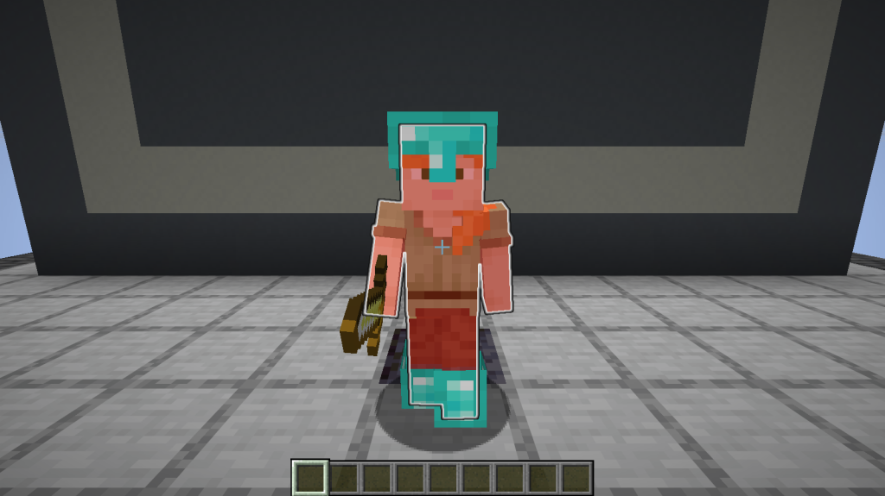
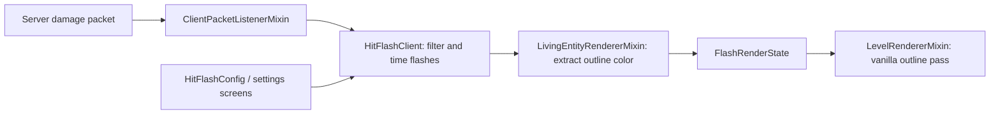

<div align="center">
<h1>HitFlash</h1>
<hr>
<p><strong>3 visual controls in one place: confirmed melee hits, outline color, flash duration.</strong></p>
<p>


</p>
<p>
<a href="https://github.com/hhhhhffd/HitFlash/releases/latest"></a>
<a href="https://github.com/hhhhhffd/HitFlash/releases"></a>
</p>
<p><a href="https://github.com/hhhhhffd/HitFlash/releases">Download</a> · <a href="#architecture">Architecture</a> · <a href="#build">Build</a></p>

</div>

## Executive Summary

HitFlash is a client-side visual mod for Minecraft Java 1.21.11. A server-confirmed direct melee hit by the local player gives the target's base model a temporary outline using Minecraft's Glowing post-processing. Armor, held items, and capes are excluded from the mask; the vanilla red damage flash is unchanged.

The default outline is white (`#FFFFFF`) for 450 ms. Visibility rays to the head, legs, and shoulders suppress the outline if any ray is blocked by a block.

## Technical Stack

| Layer | Technology | Version / role |
| --- | --- | --- |
| Core | Minecraft Java | 1.21.11 |
| Core | Fabric Loader | 0.20.1 in build; 0.18.4 or newer required |
| Core | Fabric API | 0.141.6+1.21.11 in build; required at runtime |
| Core | Java | 21 or newer |
| Integration | Mod Menu | 17.0.1 or newer, optional |
| Build | Fabric Loom / Gradle Wrapper | 1.13.6 / 9.2.1 |

## Architecture



- `HitFlashClient` accepts only direct local `PLAYER_ATTACK`, `MACE_SMASH`, or `SPEAR` damage events and tracks expiry per target. It does not infer hits when attacker information is missing.
- A separate `FlashRenderState` carries the custom outline color into the base-model render; Minecraft's outline pass handles the final effect without changing the vanilla entity-wide outline flag.
- Block collision rays prevent the post-processed outline from revealing a fully or partially obstructed target.

## Project Structure

```text
.
├── src/client/        # Client logic, settings screens, render and packet mixins
├── src/main/          # Fabric metadata, mixin declaration, translations
├── gradle/wrapper/    # Gradle wrapper configuration
├── docs/media/        # Preview image
├── build.gradle       # Loom build
└── gradle.properties  # Versions and build settings
```

## Installation

1. Remove any previous `hitflash-*.jar` from `mods`. Install [Fabric Loader](https://fabricmc.net/use/installer/) 0.18.4 or newer for Minecraft Java 1.21.11; the previous README reports testing the build with Loader 0.20.1. Java 21 or newer is required.
2. Put `hitflash-1.0.2.jar` from [Releases](https://github.com/hhhhhffd/HitFlash/releases) and [Fabric API for 1.21.11](https://modrinth.com/mod/fabric-api/versions?g=1.21.11) in `mods`. On Windows the folder is usually `%appdata%\.minecraft\mods`.
3. Optionally install [Mod Menu 17.0.1](https://modrinth.com/mod/modmenu/version/17.0.1) for the settings screen. The effect works without it; no server installation is needed.

> [!NOTE]
> On public servers, check the rules for client-side mods. HitFlash does not change combat or send its own network packets.

## Settings and Hit Detection

Open **Mods → HitFlash → Configure** with Mod Menu. The effect is enabled by default and targets all living entities; switch to players only if desired. Set the duration from 50 to 3000 ms and choose a color using the hue strip and saturation/brightness field, one of six presets, or a HEX value. Confirm the color and press **Done** on the main screen to save; Esc closes without saving unfinished edits.

Settings use `config/hitflash.json`; the previous file is read without migration. The `/hitflash` commands were removed.

A damage packet must identify the local player as both direct source and cause of a supported melee attack. Air swings, other players' damage, fire, and projectiles do not trigger a flash; missing attacker information is not guessed.

## Build

Use JDK 21 and the included Gradle 9.2.1 wrapper. The first dependency download requires internet access.

```sh
./gradlew build
```

On Windows, run `gradlew.bat build`. The output is `build/libs/hitflash-1.0.2.jar`; do not install the `-sources.jar`. To launch a local development client, run `./gradlew runClient`.

## Deliverables & Links

[Releases](https://github.com/hhhhhffd/HitFlash/releases) · [Source](https://github.com/hhhhhffd/HitFlash) · [Preview](docs/media/preview.png)

## License

Not specified; license terms are TBD.
